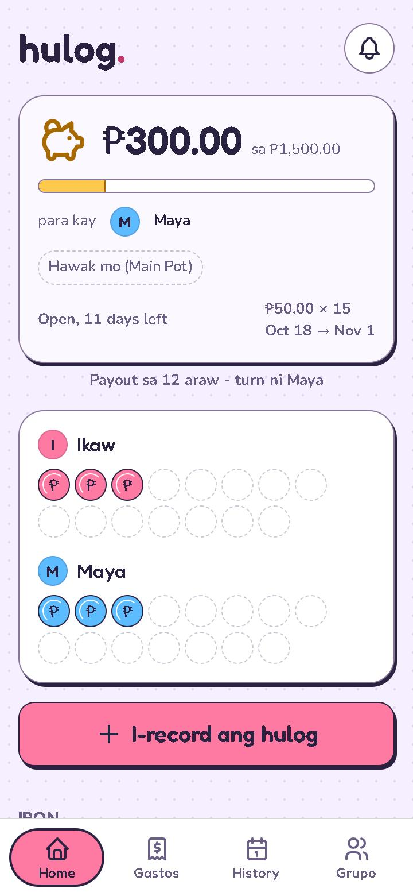
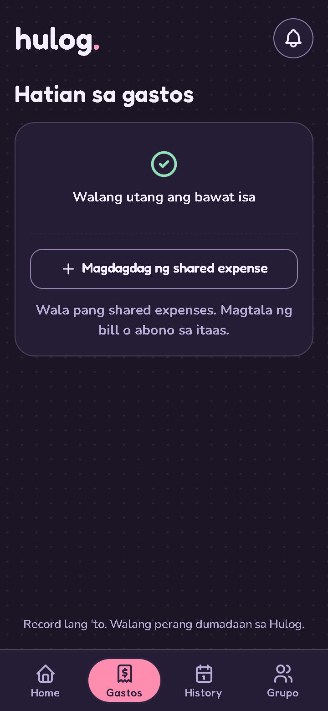
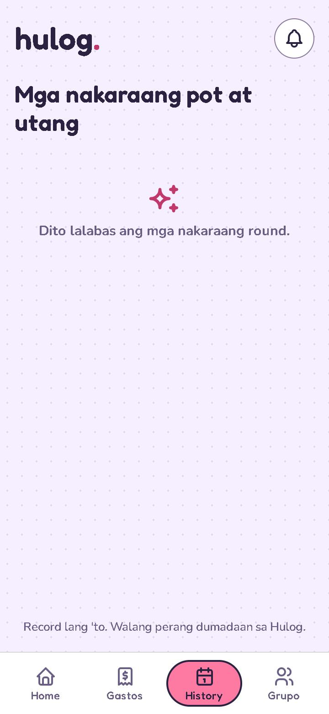

# Hulog

## Purpose

A mobile-first PWA for tracking a two-person paluwagan (rotating savings) and
shared savings goals. Live at **https://hulog.vercel.app** and in daily use.

Hulog records money; it never holds, transfers, or pays out money. See
[`docs/SPEC.md`](docs/SPEC.md) for the authoritative product requirements.

<p>
  
  
  
</p>

## Features

- Paluwagan rounds for two members: record each payment ("hulog"), see who
  receives the pot next, and close a full round early.
- Shared savings goals with mutual confirmation, plus personal savings goals
  that each member can keep private or share read-only.
- Named wallets showing who holds the money, and a shared-expense ("abono")
  tracker.
- Push notifications in the member's chosen language (English, Tagalog, or Taglish).
- Google sign-in, an offline solo mode on one device, and light and dark themes,
  usable down to 360px wide.

## Stack

React + TypeScript (Vite), Supabase (Postgres, Auth, Edge Functions), and
Vercel hosting.

- Every table has row-level security. Clients write only through scoped
  security-definer RPCs, and the acting user always comes from `auth.uid()`.
- Amounts are integer centavos; date rules use Asia/Manila.
- Payment, membership, and cycle rules are covered by Vitest unit tests and a
  pgTAP SQL test suite in `supabase/tests/`.

## 60-second start

Follow [`SETUP.md`](SETUP.md), copy `.env.example` to `.env`, then:

```bash
npm ci
npm run dev
```

Checks: `npm run lint`, `npm test`, `npm run build`, and the local SQL suite
described in `SETUP.md`.

## Current truth

[`docs/SPEC.md`](docs/SPEC.md) owns product requirements; source and migrations
in this repository own implementation. [`SETUP.md`](SETUP.md) documents setup
and manual verification. A deployed version may differ from a local checkout.

## Work map

| Task | Start here |
|---|---|
| Product behavior | [`docs/SPEC.md`](docs/SPEC.md) |
| UI and application logic | `src/` |
| Database migrations and SQL tests | `supabase/` |
| Local setup and manual checks | [`SETUP.md`](SETUP.md) |

## Boundaries

Hulog records money; it never holds, transfers, or pays out money. Keep `.env`,
credentials, and local runtime data private. See [`SETUP.md`](SETUP.md) before
changing hosted configuration or running database setup commands.

## License

MIT, see [`LICENSE`](LICENSE).
